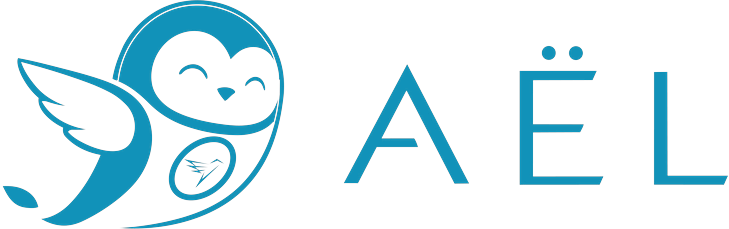
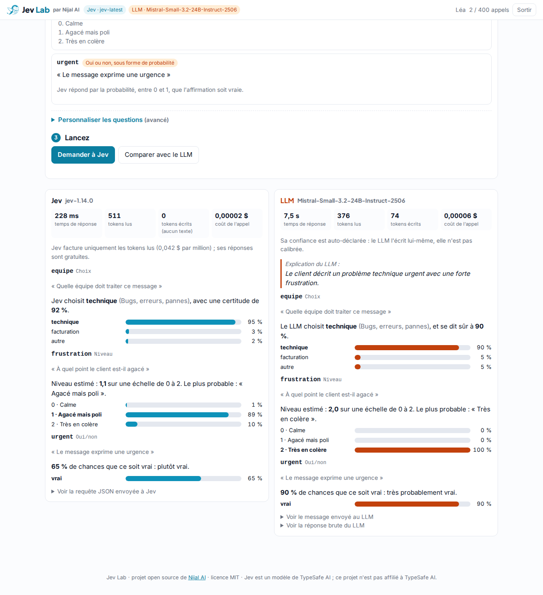
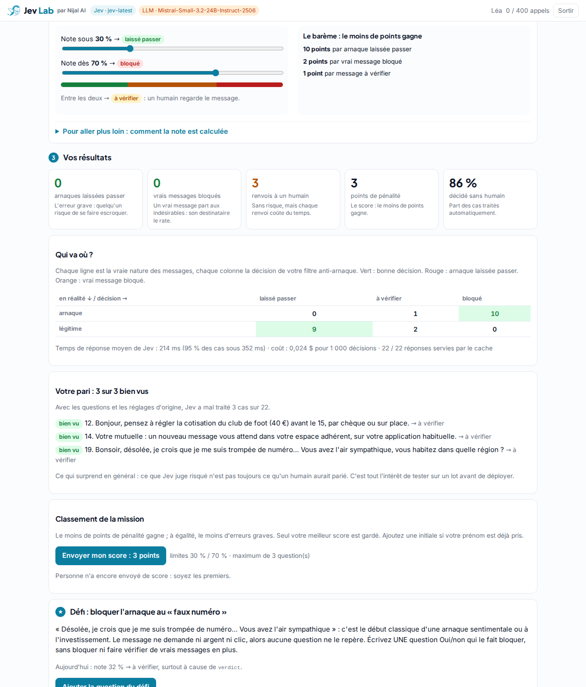

<p align="center">
  
</p>

<h1 align="center">Jev Lab</h1>

<p align="center">
  Un atelier web pour mettre à l’épreuve <b>Jev</b>, le modèle « System One » de TypeSafe AI,<br>
  face à un LLM classique. Sur téléphone ou sur PC, sans compte et sans écrire de code.
</p>

<p align="center">
  <a href="LICENSE">Licence MIT</a> · Python 3.11+ · FastAPI · une page HTML/JS sans build
</p>

---

Jev ne rédige rien : il lit un texte et répond à des questions fermées par des décisions chiffrées
(un choix, un niveau, une probabilité). Le Jev Lab fait toucher du doigt ce que ça change en 45 minutes :
régler des limites sur des probabilités, écrire de bonnes questions, et comparer avec un LLM sur la
vitesse, le coût et la fiabilité de la confiance annoncée.



## Le parcours

| Onglet | Ce que fait le participant |
|---|---|
| **1. Découvrir** | Choisit un scénario (ticket de support, message suspect, commentaire à modérer), interroge Jev puis un LLM, et lit chaque réponse expliquée en une phrase. |
| **2. Missions** | **Filtre anti-arnaque** : 22 SMS et e-mails fictifs. Il parie sur les cas où Jev va hésiter, règle deux limites (laisser passer, faire vérifier, bloquer) et vise le moins de points de pénalité. Puis le **défi** : écrire la question qui démasque l’arnaque au « faux numéro ». En bonus, un **routage de tickets**, et **Votre cas** pour construire son propre classifieur. |
| **3. Duel** | Même lot, mêmes limites, Jev contre le LLM : erreurs, latence, coût pour 1 000 décisions, erreurs de format, et un tableau de **calibration** (« quand il annonce 90 %, a-t-il raison 9 fois sur 10 ? »). |
| **Admin** | Pour l’animateur : statistiques par participant, préchauffage du cache, mode « cache seul » si une API tombe, et le classement si `LEADERBOARD_ENABLED` est activé. |



## Démarrer en local

```bash
uv sync
cp .env.example .env          # facultatif : sans clé, tout fonctionne en mode simulé
uv run --env-file .env python run.py
```

Ouvrez <http://localhost:8080/> : un prénom suffit pour entrer, c’est ce lien qu’on met derrière un QR code.
Avec `ADMIN_CODE` renseigné, saisir ce code sous « Je suis l’animateur » (ou ouvrir `/?admin=<code>`) donne l’onglet Admin.

Tests : `uv run pytest -q`.

## Configuration

| Variable | Défaut | Rôle |
|---|---|---|
| `TYPESAFE_API_KEY` | vide → mode simulé | Clé de l’API Jev, utilisée côté serveur uniquement |
| `JEV_MODEL` | `jev-latest` | Alias demandé ; l’app affiche la version réellement renvoyée |
| `LLM_API_KEY`, `LLM_BASE_URL`, `LLM_MODEL` | Mistral, `mistral-small-latest` | N’importe quel LLM compatible OpenAI (`/chat/completions`, `response_format: json_object`) |
| `LLM_PRICE_IN`, `LLM_PRICE_OUT` | 0.1 / 0.3 | Prix en dollars par million de tokens, pour le coût affiché |
| `ADMIN_CODE` | vide → pas d’Admin | Code de l’animateur |
| `LEADERBOARD_ENABLED` | `false` | Classement des participants par mission (envoi de score + tableaux de l’Admin) |
| `SECRET_KEY` | aléatoire | Signe les sessions ; à fixer en production |
| `MAX_CALLS_PER_PARTICIPANT` | 400 | Quota par participant ; les réponses en cache ne comptent pas |

## Préparer un atelier

1. Renseignez les clés, puis dans l’Admin cliquez sur **Préchauffer le cache** : toutes les missions passent sur Jev et sur le LLM.
2. **Téléchargez `cache.json`**, remplacez `data/cache.json` et redéployez : les réponses d’origine deviennent instantanées et ne consomment aucun quota.
3. Si une API tombe pendant l’atelier : Admin → **Cache seul**.

Le cache fourni dans le dépôt correspond aux jeux de cas actuels : l’app fonctionne avec de vraies réponses
de Jev et de Mistral Small sur les questions d’origine, même sans clé.

## Adapter le contenu

Tout le contenu pédagogique est en JSON, sans toucher au code :

- `data/datasets/*.json` : les missions (questions envoyées à Jev, cas et bonnes réponses, limites, barème,
  consignes, indices, défi, vocabulaire affiché) ;
- `data/presets.json` : les scénarios de l’onglet Découvrir.

Après une modification des questions ou des cas, repréchauffez le cache.

## Déployer

N’importe quel hébergeur Python convient : `run.py` lit la variable `PORT` (8080 par défaut) et écoute sur `0.0.0.0`.
Exemple avec Clever Cloud (déploiement uv) :

```bash
clever create --type python jev-lab
clever env set CC_PYTHON_UV_RUN_COMMAND "uv run python run.py"
clever env set TYPESAFE_API_KEY … # puis LLM_API_KEY, ADMIN_CODE, SECRET_KEY
clever deploy
```

## Données et confidentialité

- Tous les cas fournis sont **fictifs**. Les liens des messages d’arnaque utilisent des domaines réservés `.example`.
- L’API de Jev est hébergée aux États-Unis : n’y envoyez pas de données personnelles réelles sans cadre juridique adapté.
- Les clés d’API restent côté serveur. Classement et statistiques sont gardés en mémoire et s’effacent au redémarrage.

## Crédits

Projet open source de [Nijal AI](https://github.com/Nijal-AI), sous [licence MIT](LICENSE).
Jev est un modèle de [TypeSafe AI](https://docs.typesafe.ai) ; ce projet n’est ni affilié à TypeSafe AI ni approuvé par elle.
Le logo Nijal AI reste la propriété de Nijal AI et n’est pas couvert par la licence MIT.
